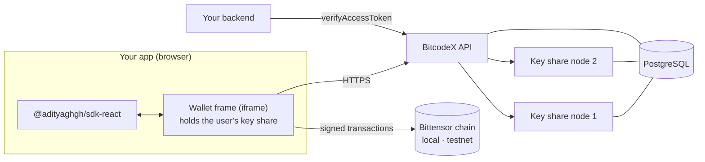

<div align="center">

# BitcodeX

### Embedded wallets for Bittensor

Sign in with Google. Get a real Bittensor wallet. Approve every action in a readable popup.<br>
No extension. No seed phrase. No single party that can move your funds.

[](https://bitcodex-demo.vercel.app)
[](https://bitcodex-demo.vercel.app/docs)


-F59E0B)

</div>

> **Early release.** BitcodeX runs on the **local test chain and Bittensor testnet only**.
> Mainnet is disabled until an independent security audit. Do not use it with real funds.

---

## Why

Bittensor turns machine intelligence into a market: subnets compete to deliver useful work
and are paid in **TAO**. Everything on it starts with a wallet, and that wallet is a heavy
front door: a browser extension or a command-line tool, a seed phrase, two kinds of keys.
Most people who would use a Bittensor-powered app never get past it.

BitcodeX does for Bittensor what Privy does for Ethereum and Solana: **log in with an account
you already have, get a wallet, approve each action in a popup that says what it does.**

Read the full story, architecture and feature matrix in **[BITCODEX.md](BITCODEX.md)**.

## What you get

| | |
|---|---|
| **Login** | Google, and any Bittensor wallet (Talisman, SubWallet, Polkadot.js) via Sign-In with Bittensor |
| **Wallet** | A real Bittensor address (starts with `5`), balances, history |
| **Money** | Send TAO, stake and unstake with exact quotes and slippage |
| **Hotkeys** | Add, register on a subnet at the exact on-chain cost, read UIDs |
| **Permissions** | Let an app or AI agent act for a user through on-chain proxies, revocable any time |
| **Safety** | Confirmation popup with plain-English cards and the fee; red warning for unknown calls |
| **Developers** | React SDK, server token verification, developer dashboard, self-host in one command |

## Quickstart

```bash
npm install @adityaghgh/sdk-react @adityaghgh/sdk-bittensor @adityaghgh/sdk-core
```

```tsx
import { BitcodeXProvider, useBitcodeX } from "@adityaghgh/sdk-react";
import { useBitcodeXBittensor } from "@adityaghgh/sdk-react/bittensor";

// 1. Wrap your app
<BitcodeXProvider
  config={{
    apiKey: process.env.NEXT_PUBLIC_BITCODEX_API_KEY!,
    sdkEndpoint: "https://wallet.your-domain.com", // your wallet frame
    bittensor: { chainId: "bittensor:testnet" },
  }}
>
  <App />
</BitcodeXProvider>;

// 2. Log in and send
const { signIn } = useBitcodeX();
const { bittensorWallet } = useBitcodeXBittensor();
await signIn("google");
await bittensorWallet.sendTao("5F…destination", "0.1"); // the user approves in a popup
```

Full guide: **[bitcodex-demo.vercel.app/docs](https://bitcodex-demo.vercel.app/docs)**.

## The four packages

| Package | Runs in | Use it to |
|---|---|---|
| [`@adityaghgh/sdk-react`](scripts/release/readme/sdk-react.md) | Browser (React 18+) | Add the provider and hooks: login, address, wallet actions |
| [`@adityaghgh/sdk-bittensor`](scripts/release/readme/sdk-bittensor.md) | Browser | Send TAO, stake, register hotkeys, grant permissions, sign messages |
| [`@adityaghgh/sdk-core`](scripts/release/readme/sdk-core.md) | Browser | The foundation: loads the wallet frame and runs login. Used by the two above |
| [`@adityaghgh/server`](scripts/release/readme/server.md) | Node 22+ (server only) | Verify logged-in users and read their wallets on your backend |

**Which do I install?**
- A React or Next.js app: `sdk-react`, `sdk-bittensor` and `sdk-core` together (the first two depend on the others).
- A backend that needs to know who is logged in: `server`.
- A non-React frontend: `sdk-bittensor` and `sdk-core`.

**Install**

```bash
# From npm
npm install @adityaghgh/sdk-react @adityaghgh/sdk-bittensor @adityaghgh/sdk-core   # frontend
npm install @adityaghgh/server                                                     # backend

# Or from the files hosted with the demo (no account needed)
BASE=https://bitcodex-demo.vercel.app/downloads
npm install $BASE/adityaghgh-sdk-react-0.1.1.tgz $BASE/adityaghgh-sdk-bittensor-0.1.1.tgz $BASE/adityaghgh-sdk-core-0.1.1.tgz
npm install $BASE/adityaghgh-server-0.1.1.tgz
```

Set `skipLibCheck: true` in your `tsconfig.json`. You also need a BitcodeX deployment: an **API key** and the **wallet frame URL** (run your own with [the self-host guide](bitcodex-spec/bitcodex-docs/SELF_HOST.md)).

**Use them together**

```tsx
// Frontend (React): log in, then hand a token to your backend
const { wallet } = useBitcodeX();
const token = await wallet?.getAccessToken();
await fetch("/api/me", { headers: { Authorization: `Bearer ${token}` } });
```

```ts
// Backend (Node): verify the token before you trust it
import { verifyAccessToken } from "@adityaghgh/server";

const result = await verifyAccessToken(token, {
  appId: process.env.BITCODEX_APP_ID!,
  apiUrl: process.env.BITCODEX_API_URL!,
});
if (!result.success) throw new Error(result.msg);
console.log(result.data.userId, result.data.address);
```

Each package has its own README with the full API: click the package name in the table above.

## How it works



The user's key is a threshold **Ed25519** key split 2-of-2 between their browser and the
server (**FROST**). A signature needs both halves, and the full private key is not rebuilt to
sign. The result is an ordinary Bittensor address that works in every tool. Hotkeys stay on the
miner or validator machine and are never created here.

## Which network each feature runs on

| Feature | Local chain | Testnet |
|---|---|---|
| Login, key creation, signing | Tested end to end | Signature accepted by the testnet's own check |
| Send, stake, register a hotkey, permissions | Tested with real transfers (62 tests) | Same code; **needs testnet TAO**, funded run not done yet |
| Faucet | Built in | None exists in the official docs; ask the Bittensor community |
| Mainnet | Disabled by design | Disabled by design |

## Run it yourself

| Goal | Command |
|---|---|
| Develop locally | `scripts/dev-up.sh` (add `--fast` for production builds) |
| One machine, one command | `selfhost/setup.sh` ([guide](bitcodex-spec/bitcodex-docs/SELF_HOST.md)) |
| Render, free to try | `render.yaml` ([guide](bitcodex-spec/bitcodex-docs/DEPLOY_RENDER.md)) |

Requires Node 22+, Yarn 4 (`corepack enable`), Rust and `wasm-pack` to build from source,
and Docker for the local database and test chain.

```bash
corepack enable && yarn install --immutable
yarn ci build_cs && yarn ci build_frost    # WASM crypto
yarn ci build_pkgs && yarn ci build_sdk    # packages and SDKs
yarn ci typecheck
```

## Repository

```
sdk/              SDKs: core, bittensor, react, server, chain helpers
embed/            wallet frame (iframe)
backend/          API, OpenAPI schemas, database migrations
key_share_node/   the two key share nodes
crypto/           Rust threshold signatures (WASM and Node addon)
apps/             demo and docs, user dashboard, developer dashboard
selfhost/         Docker setup          render.yaml   Render blueprint
scripts/          dev, release, video and check scripts
```

## Security

Only the wallet frame signs, and every signature shows a confirmation first. The frame answers
only to sites on an app's allowed-origins list, the network is detected from the chain's genesis
hash (never a name), and no key share, seed or token is logged. Found a vulnerability? Please
report it privately to the maintainers instead of opening a public issue.

## Status

- **Built:** everything above marked tested, plus hosted demo, docs, self-host and Render deploy.
- **Preview:** two-factor code before large spends, hotkey swap, coldkey swap explainer,
  Subtensor EVM address.
- **Not built:** email login, passkey login, a wallet button inside the BitcodeX popup.
- **Known limits:** Render's free plan sleeps after 15 minutes; a full browser run of every path
  with real logins is still being completed.

## Contributing

Issues and pull requests are welcome. Commits and PR titles use `<scope>: <description>`
(lowercase, imperative, for example `sdk: add proxy quote helper`). Before opening a PR run
`yarn ci typecheck` and `yarn exec biome check .`. See [CONTRIBUTING.md](CONTRIBUTING.md).

## License

[Apache License 2.0](LICENSE). Third-party components keep their own licences; see
[NOTICE](NOTICE).
