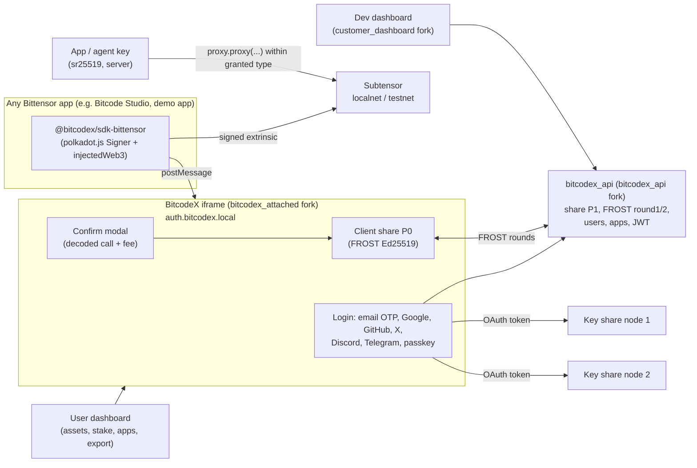

# 03 · BitcodeX architecture

## Picture

## Components

| Component | From BitcodeX | What we add |
|---|---|---|
| `embed/bitcodex_attached` (iframe) | `bitcodex_attached` | Bittensor ecosystem: chain infos, tx parser, confirm modals, fee and balance queries, passkey login, hotkey address book, proxy screens |
| `sdk/bitcodex_sdk_core` | `bitcodex_sdk_core` | new msg types for Bittensor |
| `sdk/bitcodex_sdk_bittensor` | new, modelled on `bitcodex_sdk_svm` | `BitcodexBittensor.init()`, `connect()`, `getAddress()`, `signer` (polkadot.js `Signer`), `signAndSend(tx)`, `signMessage()`, `injectWeb3()`; events `accountChanged`, `disconnect` |
| `sdk/bitcodex_sdk_react` | `bitcodex_sdk_react` | `useBitcodex()`, `useBitcodexBittensor()`, `<BitcodexProvider>`, `<LoginButton>` |
| `backend/bitcodex_api` | `bitcodex_api` | nothing in TSS. Add allowed-origins per app, Bittensor wallet record (address, created_at), optional hotkey/proxy registry |
| key share nodes | `key_share_node` | run 2 locally; same code |
| `apps/demo_web` | `demo_web` | Bittensor widgets, like demo.privy.io |
| `apps/user_dashboard` | `user_dashboard` | TAO balance + USD, stake by subnet, history, connected apps, proxies, export |
| `apps/customer_dashboard` | `customer_dashboard` | apps, API keys, allowed origins, login methods, theme |
| `bitcodex-chain` (small TS package) | new | `@polkadot/api` connection pool, chain configs, decoding, error mapping; shared by iframe, dashboards and SDK |

## Key model

- **Coldkey:** BitcodeX's Ed25519 path unchanged. Address = `encodeAddress(groupPublicKey, 42)`.
- **Hotkeys:** not in the MPC system. Created on the node machine (btcli `wallet new-hotkey` or BitNode). The user pastes or scans the hotkey address; BitcodeX registers it (`burnedRegister`) signed by the coldkey.
- **App/agent permissions:** on-chain proxies from the coldkey to an app key (X09).
- **EVM address (optional):** BitcodeX's secp256k1 threshold wallet on Subtensor EVM (X13).

## Networks

`chain_id` values: `bittensor:localnet` (ws://127.0.0.1:9944), `bittensor:testnet` (official testnet endpoint; verify URL in docs), `bittensor:mainnet` (disabled unless `BITCODEX_ENABLE_MAINNET=true`, which is not allowed before audit).

## Local deployment ($0)

One `docker-compose.bitcodex.yml`: Postgres 17, MinIO, Mailpit, bitcodex_api :4200, KSN :4201 and :4202, localnet :9944. Frontends with `yarn dev`: iframe :3201, demo :3200, user dashboard :3206, dev dashboard :3203. For a public demo link: `cloudflared tunnel --url` per frontend (OAuth redirect URLs must match; use Google OAuth "testing" mode).
